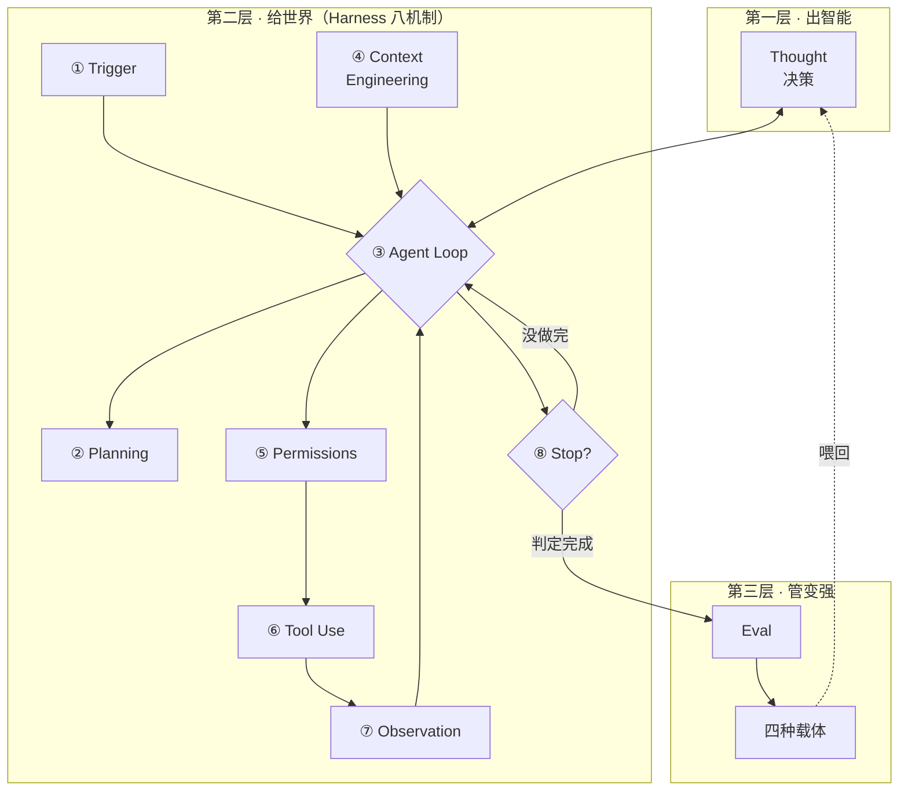

## 一、大部分教程第一屏就画错了

打开任何一个「手把手教你做 Agent」的教程，第一屏大概率是这张图：

```
用户输入 → 意图识别 → 选择工具 → 执行工具 → 组织回复
```

五个框，一条线，箭头从左到右。教程会说：这就是 Agent。

这类教程我看过不少，它们有个共同问题：这条链路上每一个分叉都是作者提前决定的。意图有几种、什么时候调哪个工具、什么时候结束，全是代码里的分支。模型在这里只干一件事，把自然语言翻译成一个标签，然后你按标签执行。

决策只发生了一次，就在第一步。后面全是既定路线。

learn-claude-code 那个项目里管这种写法叫「提示词水管工」——你以为在写智能，其实在铺管道。它救不回来，跟提示词写得好不好没关系，因为模型再强也只能在那一次决策里使劲。

真正的 Agent 是另一种东西：一个 `while True` 加一个工具。模型看消息、决定要不要调工具、调完把结果塞回去、再看、再决定。什么时候调、调几次、什么时候停，都是模型每一轮现决定的。

差别不在风格，在能力边界。前者只能处理你想到过的情况，后者能处理你没想到的。

这套东西我用了大半年。我给自己搭了一个知识库系统，让模型每天整理素材、生成页面、安排复习。跑下来最深的体会是：模型能力从来不是瓶颈。同一个模型，换一套喂法、换一套边界，效果能差出一个量级。

下面这八个机制，是我在补坑的过程中一个一个想明白的。

## 二、三个层次：谁出智能，谁给世界，谁管变强

一个 Agent 系统里同时有三类工作在发生，性质完全不同。

有一类工作在产生判断：这一步该干什么、这个工具该不该调、这个任务算不算完成。有一类工作在提供条件，让判断能落地：它看到什么、能用什么、什么不许碰。还有一类工作不在这次运行里，它决定下一次运行怎么更好。

这三类工作对应三个层次：



第一层是模型，它产生判断。这部分能力来自训练，你没法用提示词让一个模型突然学会它没学过的东西。

第二层是 Harness，字面是「马具」——套在马身上、让马能拉车的那套装备。放在 Agent 里，它就是模型之外的一切：给它什么信息、给它什么工具、允许它做什么、它做完了谁来验收。

第三层是提升，它不参与这一次运行。把真实运行里的错误变成评测集，再沉成知识、提示词、程序、模型参数四种载体，喂回下一版。

分这三层不是做学问，是因为混在一起会做错事。

举个具体的。模型答得不好，很多人的第一反应是改提示词、加编排、加流程。但如果这个问题出在模型能力边界上——它根本没见过这类任务的训练数据——你在第二层怎么改都没用，得等第一层升级，或者到第三层去补数据。

反过来，模型够强但经常越权操作，那是第二层的问题，跑到第三层做微调是浪费。

分清层次，才知道该在哪一层使劲。

还有一句判断，我觉得值得单独拎出来：

> Agency 来自训练，不来自编排。

它解释了为什么有些 Agent 看起来很聪明、有些怎么调都很蠢。问题不在编排，在模型本身的能力边界。所以 Harness 工程师的活是把世界造好，智能不归你写。

## 三、八个机制

Harness 这一层里有八件事要做。恢复口诀是八个字：唤 · 规 · 环 · 境 · 闸 · 动 · 观 · 收。

这八个字是记忆钩子，不是执行顺序。为什么不是顺序，第四节讲。

### ① Trigger（唤）：Agent 不在场的时候，谁来叫它

很多人对「常驻」有误解，以为 Agent 得一直开着进程占着电脑。不是。

常驻的意思是「随时能被叫醒」，不是「一直醒着」。实现方式是事件：来消息了、来邮件了、定时器到了，才把一台独立虚拟机里的循环叫起来。没事的时候它就该睡着，不占资源。

要让这件事成立，系统最少得有三块，缺一不可。事件入口负责感知「有事发生」，没有它 Agent 不知道自己该干活了。服务端负责调度，决定叫醒谁、给它什么上下文。工具计算机是一台独立的 VM，Agent 真正跑起来的地方。第三块为什么必须独立？因为它要执行模型生成的代码、要访问外部系统，跑在你自己的机器上迟早出事。

描述这类 Agent 有三个词，经常被混用，其实侧重完全不同。always-on 说的是可用性，你离线它继续跑。persistent 说的是状态，经验和记忆持续积累，不是每次都从零开始。proactive 说的是主动性，不必等你每次手动提示。

第三个词的后半句最容易被漏掉：主动也包括知道什么时候该保持安静。

主动不是「一直找你说话」。一个天天推送无用提醒的助手，比一个安静的助手更烦人。什么时候不说话，和什么时候说话一样重要。

我给自己的知识库做了个晚间复盘：每天固定时间跑一次，读当天的记录，生成第二天的计划。这里有个选择：用定时器每天拍醒一次，还是等有事件才触发？

我选了定时器。理由很简单：这个任务一天只跑一次，没有即时性要求，晚跑十分钟没人受影响。但如果哪天它没跑，我不会知道，直到第二天发现计划是空的。所以真正的成本不是「多跑了几次」，是「漏跑了我不知道」。

后来我给这个定时任务加了个最简单的兜底：跑完之后写一行状态，第二天跑之前先读这一行。状态不对就报警。这一行状态比整个调度逻辑都重要。

### ② Planning（规）：为什么「先列步骤」能让完成率翻倍

有句话在实践里被反复验证：先列步骤再动手，完成率翻倍。

这不是玄学，原因很具体。模型在没有显式计划时，容易走一步看一步，走到中途就丢失了原始目标。尤其是任务超过十几轮的时候，开头那句「用户到底要什么」已经被后面的工具结果淹没了。

把 todo 写出来之后，目标从「上下文里的隐含意图」变成了「列表里的明确条目」。每一步执行前都能对照一下：我现在做的这个，和列表上那条对得上吗？

更进一步的做法是把任务落盘，写进存储，不是留在上下文里。每条任务带 `blockedBy` 字段记录依赖关系，串起来就是一张任务图。

好处立刻体现：进程挂了、上下文丢了、机器重启了，任务图还在，能接着干。

我的学习材料一开始全堆在一个文件里。越写越长，想找某个机制在哪一段得从头翻，想补一个细节又怕把整体结构搅乱。后来拆成了一个总览页加几个分册：总览页只留脉络和状态，细节全进分册。

这其实就是任务落盘：主上下文里只留指针，细节存在外部，需要的时候再取。拆完之后总览页清爽了，细节也没丢。

这张任务图后来还成了多 Agent 协作的底座——多个 Agent 认领同一张图上的不同节点，各自推进，靠依赖关系协调，不用互相喊话。

### ③ Agent Loop（环）：整个系统的中心

最小循环的伪代码五行就写完了：

```python
messages = [{"role": "user", "content": task}]
while True:
    resp = model(messages)
    if not resp.tool_use:
        return resp.text
    messages.append(resp)
    messages.append(run_tool(resp.tool_use))
```

就这些。没有编排器，没有状态机，没有 DAG。

三个地方值得停下来看。

`messages` 是唯一持续生长的东西。系统的全部状态都在这一个列表里，别的地方不存东西。

循环什么时候停，是模型通过 `end_turn` 决定的。你数轮数不算，超时兜底也不算。是模型自己说「我不需要再调工具了」。

你写的代码只做模型的「手脚」，不做模型的「大脑」。`run_tool` 负责执行，`model` 负责决策，这两件事不能混。

这里有一条很重要的切分，值得单独说：

> 循环属于 Agent，机制属于 Harness。

为什么这一刀要切在这里？因为切错了会出两种后果，都很严重。

第一种是决策外置成编排。你把「什么时候调工具」写进代码，模型就退化成了标签分类器。看起来还在用大模型，实际上它只负责把用户的话翻译成你预设的某个分支。这就是开头说的「提示词水管工」。

第二种是机制焊死进主循环。你想加个日志或者权限检查，都得改循环本身。改着改着循环变成一坨，谁也不敢动。

有个简单的检验标准：加一个新工具，只加一个 handler，循环不动。

我的站点有一百九十多个页面，全由一个构建脚本从 markdown 生成。加一种新页面，只需要加一个渲染函数，主流程一行不改。这个结构撑了三个月没动过，因为它就是「加一个 handler」的形态。

### ④ Context Engineering（境）：模型能看到的，只有上下文

如果八个机制只能留一个，我留这个。

先理解一个前提：模型看不到你的数据库，也看不到用户刚才在界面上点了什么。它能看到的全部，就是你这一轮喂给它的那段文本。

这段话不只是对话历史。它还包括工具定义、系统提示词、状态栏。凡是进了窗口的，都是上下文。

所以「怎么喂」这件事，比「喂哪个模型」更能决定效果。这里有三个抓手。

第一个是缓存友好。

这里有个非常具体的坑：系统提示词和工具定义一旦确定，就不要改——哪怕多一个空格。原因在大模型的注意力机制，它是因果的：第 k 个位置的 token 一变，从 k 开始后面全部失效，prefill 要整段重算。

我自己量过一次。缓存正常命中时，九成以上的 token 走缓存读，一个任务花一毛到一毛八。换个网关，缓存全丢、每轮全量重算，同样五十轮的调试会话，成本从一块五涨到十五块。

还有个更隐蔽的：会话中途切模型，会整体作废前缀缓存，因为缓存是模型作用域的。切回原模型，还得再付一次写入溢价。要换模型就开新会话，别在中间切。

顺带要分清两层缓存，它们经常被混为一谈：

| | 管什么 | 作用范围 | 价格 |
|---|---|---|---|
| KV Cache | decode（生成提速） | 单次请求内 | 免费，自动 |
| Prompt Cache | prefill（前缀复用） | 跨请求 | 缓存读约 1/10 价 |

第二个是按需加载。

工具和 Skills 不要一次全塞进 prompt。先列一个目录，名字加一句描述，模型判断需要哪个，再展开细节。

这样上下文占用从「全量」降到「目录 + 用到的那几个」。目录很小，常驻没问题；正文很大，按需才加载。

第三个是压缩。

上下文满了怎么办？很多人的第一反应是扩窗口。但扩窗口治标不治本，而且贵。

正确的做法是分四步，顺序固定，先无损、再可恢复、最后才有损。大结果转存到文件，上下文里只留路径和一个短预览；超长历史归档，保留头几条、尾几条，中间打个标记；旧的工具结果换成可恢复的占位符；实在不行，才让模型对历史做摘要。第四步最贵也最损，所以放在最后。

但有一条判断比技术细节更重要：隔离优于压缩。

与其把噪声压进上下文再压缩，不如一开始就不让它进来。让子 Agent 去处理脏活，只回传「任务 + 结论」两条消息给主循环。这样主循环的上下文永远是干净的，不用压缩。

### ⑤ Permissions（闸）：动作之前，先过一道门

核心一句话：先划边界，再给自由。

两个容易搞错的点。

权限挂在每次 Action 前面，入口查一次是不够的。用户进门时验一次身份，然后全程放行。这是最常见的错误。真正的风险不在「他是不是这个人」，在「这个人现在要做这件事，该不该允许」。

权限挂在循环上，不写进循环里。用 hook 在工具调用前后留插口，而不是在循环代码里写 if-else。这样加一条权限规则，不用改循环。

实际处置通常分四层，按风险递增：

| 层 | 策略 | 例子 |
|---|---|---|
| 1 | 只读，自主执行 | 查资料、读文件 |
| 2 | 预批准执行 | 已授权的常规操作 |
| 3 | 先问再执行 | 有副作用的操作 |
| 4 | 永远归人 | 改密码、转账、永久删除 |

第二层有个原则叫授权不级联。批准了「读这个目录」，不等于批准了「读这个目录下的所有子目录，再删掉」。每一次扩权都要重新确认，不能顺着上一次的授权往下滑。

第四层不能省。有些操作就是不该交给模型，无论它多聪明。这条线划在哪，是这个系统里最需要人拍板的地方。

我的知识库在这一点上栽过一次。九月初我做了一轮目录治理，把结构理清楚了。结果接下来四天，模型新建了三十份文件，没有一份是更新已有的正本。它每一轮看到的是「这里还缺一份总结」，于是补一份新的，而不是去改那份已经有的。

目录治理治的是「东西放在哪」，没治「产出的时候该不该新建」。这两件事不是一回事。

后来我加了一条硬规矩：产出新内容之前先查登记表，能找到对应主题就写进那个文件，不新建。新建必须有理由，还得登记。规矩写进文件顶部的约束区，不是写进提示词，因为提示词会被稀释，文件顶部的约束每一轮都在。

### ⑥ Tool Use（动）：真正改变世界的一步

前面七件事里，只有这一件会留下痕迹。别的都是看、想、判断，只有 Tool Use 会真的动到外部世界：发出去一条消息，或者改掉一个文件。

加工具的检验标准前面提过：加一个工具，只加一个 handler。用 dispatch map 做映射，工具名对应处理函数，循环里只有一句「查表执行」。加工具就是往表里加一行。

工具按用途大致分五类：感知（读）、执行（写）、协作（找人）、事件触发（定时）、用户沟通（回话）。MCP 的价值在于把这些都接进同一个工具池，不用为每个工具写一套适配。

工具描述就是设计。描述里要写清楚「什么时候用我」和「什么时候别用我」，参数要给具体例子。有个实测数据：把工具描述写清楚，调用错误率能降 45%。这不是小数目。工具调错一次，后面可能要花十轮来收拾。

工具多了怎么办？先索引，再读取细节，和 Skills 一个思路。不要把所有工具的完整 schema 一次塞进去，那会把上下文撑爆，而且大部分用不上。

还有一条容易被低估的：Coding 是通用 Agent 的元能力。

代码不只是一个工具。它是思考的载体（把推理写成可执行的）、约束的表达（用代码保证而不是靠模型自觉）、环境的适配器（什么系统都能接）。这也是为什么 coding agent 的执行面，往往是一切 Agent 的基底。

工具好用是一回事，工具产生的副产品是另一回事。我为了验收页面效果，写了个脚本自动截图。好用，一周能截几十张。一个月后回头看，仓库里堆了两百张截图、七十多兆，其中五十九张还进了 git 历史。

工具本身没错，错在它的产物没有归宿。后来我把输出目录统一改到一个被忽略的临时目录，脚本跑完就扔。工具加进来的时候，得连它的副作用一起设计。

### ⑦ Observation（观）：看不见，就等于没发生

规则很硬：一个 `tool_use` 必须有一个 `tool_result`。

不是「成功了才回」。失败了要回、被拒绝了要回、超时了也要回。原因很直接：模型下一轮靠这个判断世界状态。你不回，它不知道发生了什么，只能瞎猜或者重试。而重试一个已经成功的写操作，可能就是二次扣款。

这里有个关键区分，很多人会混：

> 去重 ≠ 幂等。

去重是「同一个结果重复进来，丢弃」。幂等是「同一个操作重复执行，副作用只发生一次」。两件事解决的是不同问题。去重解决消息重复投递，幂等解决操作重复执行。只做去重，重复执行照样出事。

慢操作怎么办？丢后台，Agent 继续思考别的事，完成后注入一条通知。不要让整个循环卡在一个 30 秒的 HTTP 请求上，那 30 秒里模型什么都干不了。

这一条我付出过最大的代价。

十月初我做了一轮代码精简，删掉了一批不再使用的组件类，但底部的注册语句忘了删。浏览器执行到那一行时抛异常，整个脚本崩溃。连它前面已经注册好的组件也一起没生效。

后果是：八百八十七个可翻面的问答组件，在一百四十九个页面上全部变成空白；两千多个折叠面板失效；全站的云同步静默关闭。而最痛的是复习页的自测区：五道题只剩下编号，题干和答案都不见了。那是整个系统的主回路。

这些页面在我眼里一直是「好的」，因为我从没打开看过。测试也一直是绿的。七套测试全在检查构建出来的 HTML 字符串，标签确实都在，没有一套真的加载那段 JS 去看它有没有渲染出来。

十八天后我才发现。

「标签在」不等于「渲染成」。我的测试一直在验证「我写了什么」，没有验证「用户看到了什么」。后来补的那套测试只做一件事：真的加载组件库，检查每个用到的标签都有对应的定义。补完之后我把它放回故障版本跑了一遍，报九项失败，能拦住。

看不见就等于没发生。这句话对模型成立，对自己的测试也成立。

### ⑧ Stop Condition（收）：模型说「做完了」，不算完

这条最反直觉，也最容易被跳过。

模型有很强的「过早认为任务完成」的倾向。它倾向于给出一个看起来完整的答案，而不是真的完成了任务。这个失败模式最危险的地方在于：死状是「看上去毫无破绽的答案」。你读一遍觉得挺好，交付出去才发现关键的那一步根本没做。

解法是独立审查：每次准备停止时，由一个独立的判断器对照原始目标审一遍。

这个模式在实践中叫提议者-审核者。提议的人说「我完成了」，审核的人问「对照目标，真的完成了吗」。两个角色必须分开——让同一个模型自己审自己，等于没审。

三种情况要把控制权交还用户：目标本身不可能达成、执行失败了、或者超过续跑上限（一直循环但没进展）。

「交还用户」不是失败，是设计。一个不知道该停的 Agent，比一个会求助的 Agent 危险得多。

我给自己定过一条规矩：模型写的东西，只有我逐段读过并确认过，才能标成「已核对」。在那之前，无论它看起来多完整，状态都是「待核对」。

这条规矩救过我一次。有一次整理项目复盘，稿子写得条理清晰，我差点直接标成「已核对」。后来翻原始记录才发现，其中一条「踩过的坑」根本不成立——那是设计上防的东西，不是真发生过的事故。再过一天再看，又发现前一个判断也说过了头：原始记录里确实有当事人自述，只是不该和另一个数字绑在一起讲。

三天，三次判断，两次是错的。如果第一次就标了「已核对」，后面两次都不会发生。

所以「做完了」这件事，不能由做的人自己说。得有一个不参与执行的环节，拿着原始目标去对。

## 四、为什么这不是一条流水线

现在回到开头那个问题。

如果你把八机制按 ①→⑧ 理解成执行顺序，那你又回到了「提示词水管工」——只不过这次是八个阶段串起来的流水线。

正确的拓扑是中心辐射：Agent Loop 是中心，其余七个挂在环上。

Trigger 在环外，负责把环叫起来。Planning 被环调用，产出任务图。Context Engineering 每轮喂料给环。Permissions 挂在 Tool Use 前面。Observation 把结果送回环。Stop 决定环什么时候退出。

ReAct 三元组（Thought → Action → Observation）是在环内转的，不是一个阶段。Thought 属模型侧，Action 和 Observation 属动作侧。

为什么这个区分重要？

因为如果你把八机制当顺序背，你会自然地去写一个「流程引擎」——八个阶段串起来，每个阶段一个模块，中间用事件总线连。看起来很工程化，实际上又回到了编排。

环是中心，其余是挂在环上的东西。记住这一句，比记住八个名字有用。

## 五、十个问题，检验你是否真的懂了

前面讲的是框架。框架容易背，难的是落到具体问题上还能答得出来。

下面十个问题都是真实业务场景里会遇到的。它们有一个共同点：光知道机制名字答不出来，得知道机制之间的配合，还得知道每种做法新增了什么故障面。

可以拿来自测，也可以拿去问别人。

这十题不是从书上抄的。有几道是我自己踩过之后才想明白的——第 7 题那种重复副作用，我是先出了事，回头才知道该怎么答。

**1. 什么时候该用 Agent，什么时候该用单次调用或确定性工作流？你怎么证明这个选择是对的？**

后半句才是重点。很多人能说出「复杂任务用 Agent」，但被问「怎么证明」就卡住了。证明方式只有一个：同一批真实任务，两种方案各跑一遍，比完成率和成本。

**2. Agent 执行太慢，怎么定位瓶颈、怎么定优化优先级？**

「慢」是个笼统的感受。要拆开：是模型推理慢、工具执行慢、等用户确认慢、还是排队慢？四段分别计时，才知道该优化哪一段。

**3. 探索、执行、验证、停止条件各是什么？哪些约束该靠提示词，哪些必须靠运行时保证？**

后半句是分水岭。凡是「错了会出事」的约束，都不能交给模型自觉——要用代码保证。提示词只适合表达「倾向」，不适合表达「必须」。

**4. Prompt 审查、标题生成、记忆更新这类旁路任务，什么时候触发、给什么上下文、谁阻塞主循环谁异步？**

判断标准只有一条：这件事的结果会不会影响下一轮决策？会，就必须阻塞；不会，就异步。按这个标准，权限检查是唯一必须阻塞的，标题生成、记忆更新都该异步。

**5. 主 Agent 和子 Agent 之间怎么传上下文？权限怎么隔离？子任务超时、取消、失败怎么处理？**

三态要分开上报。超时是「不知道有没有做成」，取消是「确定没做」，失败是「确定做错了」——混在一起报，上层没法正确处理。

**6. 怎么把执行过程展示给用户，让他知道进展、判断异常，又不被日志淹没？**

这是个真问题，也是很多产品做砸的地方。解法跟「少打日志」无关。得先把内部事件统一起来（推理摘要、工具调用、失败原因各是一种事件），UI 只读内部事件，不直接读日志。

**7. 工具调用超时了，能不能重试？怎么避免重复副作用、重复计费？**

关键认知：超时 ≠ 失败。超时只代表调用方没拿到结果，远端可能已经执行完了。所以只读操作可以随便重试；写操作要先问幂等——有幂等键才敢重试，没有就走人工确认。而且系统里必须承认「未知」这个状态，不能把「不知道」写成「失败」。

**8. 用户刷新页面、断线重连、中途打开，怎么保证执行状态和界面一致？**

原则是状态归后端持久化，界面只是只读渲染。前端不存权威状态，重连时拉最新状态对齐。恢复的时候要注意：是从已确认的状态继续，不是把整段重跑一遍。重跑会把已提交的副作用再做一次。

**9. 长期记忆从哪来、作用范围多大、怎么更新、怎么撤销？撤销之后已经产生的外部副作用怎么办？**

最后一问最狠。记忆可以删，但它之前导致的操作删不掉——比如它让 Agent 发过一封邮件，邮件已经发出去了。所以写入记忆时就得带来源、时间、作用范围、置信度。撤销时得列清单：这条记忆影响过哪些决策、那些决策产生过哪些外部动作，逐个处理。

**10. 后台任务进程崩了怎么恢复？怎么防止旧任务晚完成、覆盖了新结果？**

「重新喂历史让模型继续」是危险实现——它会让模型重做已经提交过的副作用。正确做法是从 checkpoint 继续：当前状态、已提交动作清单、待确认动作、外部资源标识、剩余预算、上次为什么停。防覆盖用一个东西就够：任务代际戳。每次任务重新开始就递增，写结果前比对代际，旧代际的晚到结果直接丢弃。

---

这十题有个共同点：它们问的不是「机制是什么」，而是「机制之间怎么配合，以及这么配合会新增什么故障面」。

答得出机制名字，是第一层；答得出故障面，才算真懂。

## 六、三个还没定论的问题

写到这里，有几个问题我认为还没有公认答案，列出来供讨论。

**心跳还是纯事件驱动？**

心跳是每 30 秒拍醒一次，没事继续睡；纯事件驱动是来了消息才醒。选哪个取决于「漏掉的代价」和「空转的成本」谁更大。五百人的群助手，我倾向于心跳——漏掉一条消息的代价远大于一天空转一百四十多万次的成本。但如果是百万租户的平台，空转就是二十八亿次一天，必须纯事件驱动。

**工具发现走哪条路？**

一条是「模型原生」——模型自己知道该调什么；一条是「索引制」——先给目录，需要了再查细节。我的判断是：索引制现在是主流，模型原生是方向。但这个判断可能会变。

**停止判断器用什么？**

同模型再审一遍、换个小模型、还是纯规则校验？成本从高到低，置信度也是从高到低。我目前倾向「先规则校验，兜不住再同模型二遍」——但这是工程权衡，不是定论。

## 七、最后一句

模型决定上限，Harness 决定这个上限在你的业务里能兑现多少。

这两句话听上去像句正确的废话，直到你真的被一个静默失效的组件库坑掉十八天，被三十份重复文件坑掉一轮治理，才会知道第二半句有多重。

同质化模型的时代，竞争力不在你用了哪个模型。在你能不能把上下文喂准、把权限边界划清、把结果回灌全、把停止判断做对。

工程师的活是把世界造好。智能不归你写。

---

*本文的框架受李博杰《AI Agent 应用开发实践》（[GitHub](https://github.com/bojieli/ai-agent-book)，Apache-2.0）与 [learn-claude-code](https://github.com/shareAI-lab/learn-claude-code)（MIT）启发，部分观点来自公开技术讲座。文中引用的外部数字均转述自上述公开资料，非本文作者实测；作者自己系统上的数字来自实际运行记录。*
